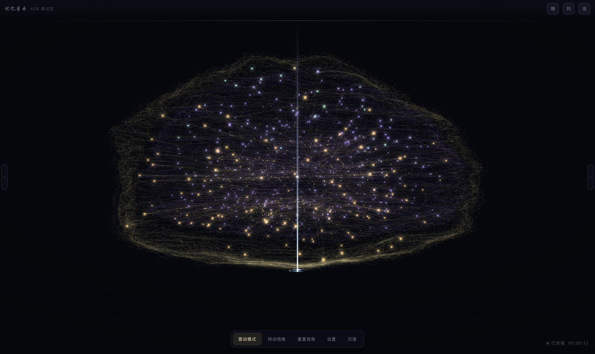
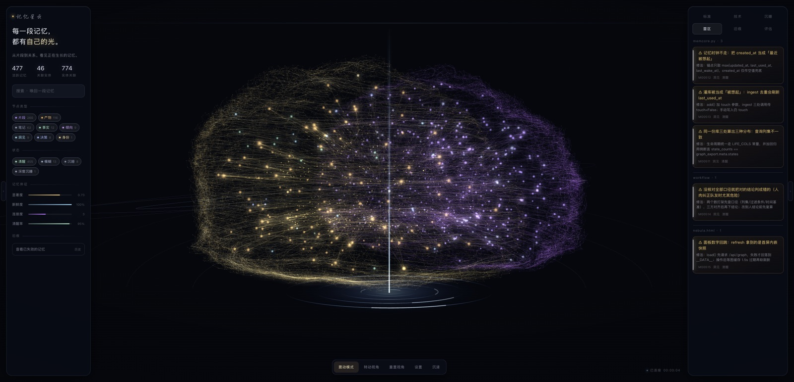
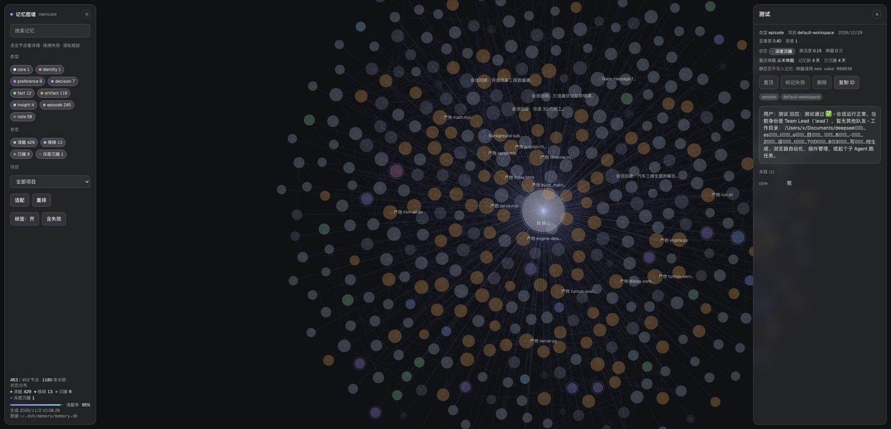
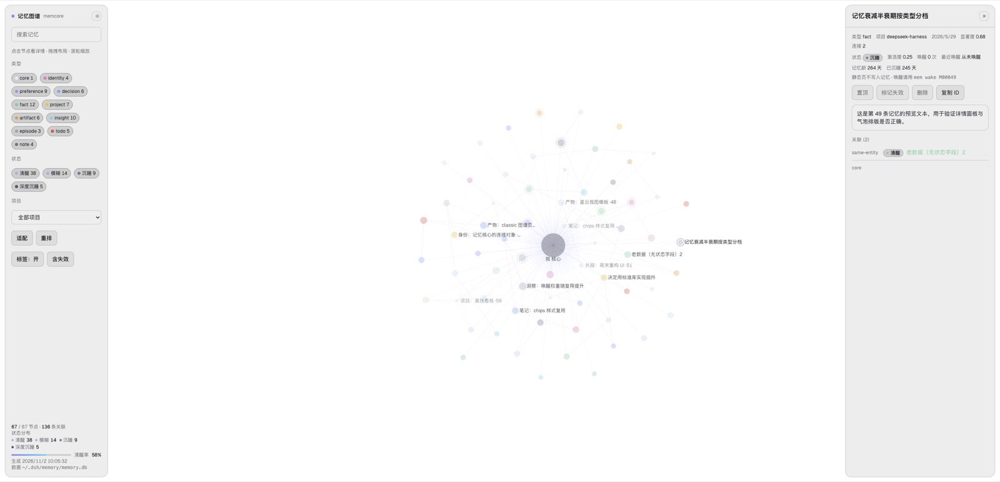
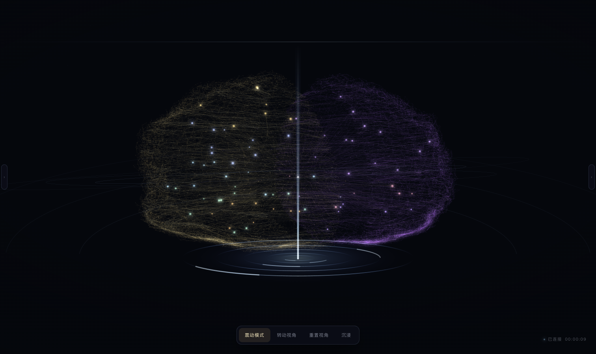
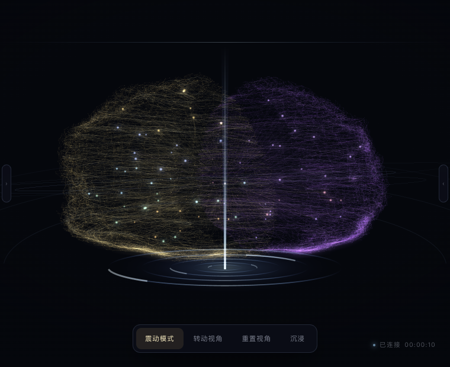
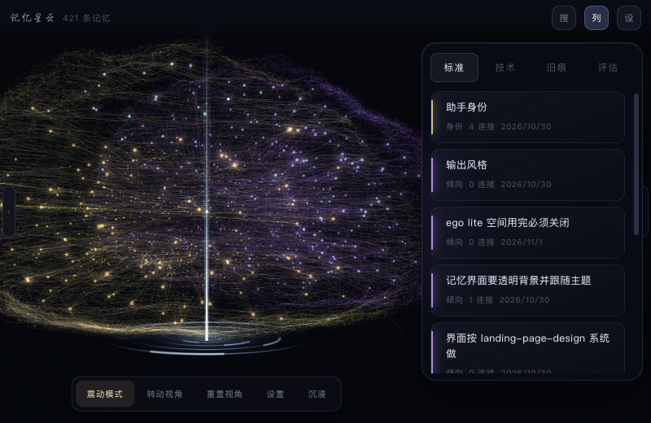

# memcore · 给智能体的本地长期记忆

[](https://github.com/YiIimini/memcore/actions/workflows/test.yml)
[](LICENSE)
[](https://www.python.org)

**单机、零依赖、可解释的长期记忆库。** 写入去重、混合检索（FTS5 + 哈希 n-gram 语义）、
图谱关联、token 预算打包、历史会话灌入、MCP 工具暴露，外加一个把记忆画成 3D 大脑的面板。



> **English TL;DR** — A local, dependency-free long-term memory store for LLM agents.
> SQLite (FTS5 + hashed n-gram vectors) retrieval fused with RRF, dedupe on write,
> budget-packed context, MCP tools, and a zero-dependency WebGL2 "memory nebula" panel.
> Python 3.9+, stdlib only. `mem serve` → http://127.0.0.1:8790/

**记忆会老**：激活度按"时间 × 重要度 × 唤醒权重"分四档 —— 清醒 / 模糊 / 沉睡 / 深度沉睡。

| 星云面板 | 沉睡区 |
|---|---|
|  |  |
| **雷区页签**（按文件归档的坑） | |
|  | |
| 经典图谱（状态分布 + 清醒率） | 浅色宿主下的面板 |
|  |  |

| | |
|---|---|
| 双栏收起 |  |
| 窄屏自适应 |  |
| 设置页内嵌（紧凑顶栏） |  |

```
~/.dsh/memory-core/          代码
├── mem                      CLI 入口（Python 3.9+，仅标准库）
├── memcore.py               引擎：存储 / 索引 / 排序 / 打包 / 维护
├── mem_mcp.py               MCP stdio 服务：memory_search|recall|brief|add|get|stats
├── bench.py                 规模与延迟基准
├── tests_eval.py            真实语料上的中文改写检索评测
├── tests/test_memcore.py    引擎单元测试
├── tests/test_server.py     面板安全回归（Host/Origin/上限/注入）
├── ui/nebula.html           记忆星云（3D 鎏金大脑，零依赖 WebGL2）
├── ui/index.html            经典 2D 力导向图谱（/classic）
├── docs/DORMANCY-CONTRACT.md 记忆模糊/沉睡的数据契约（UI 与引擎的唯一约定）
├── SKILL.md                 使用纪律（何时查、怎么写）
└── tools/sessions_dump.js   解压 dsh 会话归档

~/.dsh/memory/               数据
├── memory.db                SQLite(WAL)：memories/tags/entities/links/vectors/FTS5
├── journal.jsonl            追加写日志（审计 / 恢复）
├── MEMORY.md                人类可读镜像（每次写入后重建）
├── BRIEF.md                 会话开场简报
└── config.json              权重与阈值（可调，不需改代码）
```

## 0. 两种视图

```bash
mem serve --port 8790
# http://127.0.0.1:8790/        记忆星云（3D 鎏金大脑 + 记忆光流）—— 默认
# http://127.0.0.1:8790/classic 经典 2D 力导向图（原界面）
```

星云视图 `ui/nebula.html`：零依赖 WebGL2，脑壳点云 + 螺旋纤维 + 白质放射纤维 + 记忆节点光流 +
离屏辉光；左侧栏走 `/api/graph`，右侧栏按 标准/技术/旧痕/评估 分类。拖动旋转、滚轮缩放、点节点看详情。

**自适应与入口**（任何宽度都退得回来）：

| 情况 | 行为 |
|---|---|
| 窗口 < 1000 / < 820 | 自动收起右栏 / 左栏，画面重新居中并缩放（相机平滑过渡，不是跳变） |
| 窗口 < 900 或高 < 560 | 进入紧凑模式：顶部出现「记忆星云 · N 条记忆」+ 搜/列/设三个按钮，侧栏改成按需滑出的浮层，相机同时拉近 |
| 屏幕左右边缘 | 常驻竖条把手 `‹ ›`，收起后点它就能打开，不存在"关掉找不回来" |
| 底部 hold 栏 | `沉浸` 只隐藏两栏，dock 保留且半透明悬浮，`退出沉浸` 或 `Esc` 恢复 |
| 折叠状态 | 记在 localStorage；自动折叠不算用户选择，不会污染下次打开 |
| 页面构建 1~3 秒 | 全屏启动遮罩「正在点亮星云」，避免新窗口打开时白屏被当成故障 |
| 设置面板工具栏 | `复制链接` 兜底：宿主拦 `target=_blank` 时也能把地址拿去浏览器打开 |

## 0.5 安全边界

面板只绑 `127.0.0.1`，但"本机"并不等于"可信"——浏览器里任何一个网页都能向回环地址发请求。
所以请求门是默认拒绝的：

| 面 | 做法 |
|---|---|
| Host | 必须是 `127.0.0.1` / `localhost` / `::1`，否则 421（挡 DNS rebinding） |
| CORS | 只回显回环 Origin，从不下发 `*`；外来 Origin 拿不到任何读取授权 |
| 写操作 | Origin 非法直接 403；破坏性动作校验 id 形态并返回真实结果 |
| 请求体 | 上限 1 MiB，超出 413；查询参数限幅（`limit ≤ 2000`） |
| 连接 | 15 秒读超时，慢连接不长期占线程 |
| 响应头 | `nosniff` + `Referrer-Policy` + CSP（含 `frame-ancestors`） |
| 内嵌数据 | `<` 与 U+2028/2029 全部转义，记忆正文无法打断 `<script>` |
| 网关 | `llm.base` 只接受 https 或回环 http，且只对已配置地址附带本机 Key，禁止跟随重定向 |
| 凭据 | `secrets.json` 以 0600 创建（先建文件后写内容，无 0644 窗口） |
| 索引 | 只读文档类文件；`.ssh/`、`.aws/`、`.env`、`secrets.json` 等一律不读进记忆 |

`tests/test_server.py` 把上面每一条都钉成回归测试。

## 1. 数据模型

| kind | 用途 | 默认显著度 / 半衰期 |
|---|---|---|
| identity | 我是谁、运行环境 | 1.00 / 10 年 |
| preference | 用户长期口味与约束（建议 pin） | 0.90 / 2 年 |
| fact | 可验证事实、路径、端口 | 0.70 / 18 月 |
| decision | 决策 + 理由 + 被放弃的替代 | 0.80 / 8 月 |
| project | 项目状态、里程碑 | 0.85 / 4 月 |
| artifact | 产物文件与要点 | 0.60 / 6 月 |
| insight | 复用型经验 | 0.70 / 13 月 |
| todo | 未闭环 | 0.75 / 30 天 |
| episode | 会话片段（原话 + 回应） | 0.45 / 45 天 |
| note | 其它 | 0.50 / 6 月 |

每条记忆：`id, kind, title, body, project, tags, source, source_ref, created_at,
updated_at, last_used_at, use_count, salience, confidence, pinned, ttl_days,
hash, meta, sim`。`hash` 保证精确去重，`sim`（64 位 SimHash）做语义预筛。

## 2. 检索：五路信号 → 融合 → 去冗余 → 打包

```
query
 ├─ 词法：FTS5(trigram) + 中文 3-gram 滑窗 OR + BM25        权重 .38
 ├─ 语义：特征哈希向量(512d, 字/词 bi-gram+tri-gram) 余弦   权重 .16
 ├─ 覆盖：查询 n-gram 在正文的覆盖率（非对称，短查询不吃亏） 权重 .12
 ├─ 标题：查询 n-gram 在标题的覆盖率                        权重 .16
 └─ 先验：时近(按 kind 半衰期) + 显著度 + 复用次数 + pin     权重 .10/.08/.06/.10
        ↓  证据门（无任何词法/语义/覆盖证据的条目不参与，pin 也不例外）
        ↓  MMR 去冗余（SimHash 汉明距离 ≈ 余弦，快 50×）
        ↓  按 token 预算贪心打包 → 带 ID 的紧凑上下文块
```

- 中文不依赖分词器：3-gram 命中做召回，2-gram 覆盖率做精排。
- 短查询不因文档长而被稀释（覆盖率按查询侧归一）。
- `pinned` 只加权重，不越过证据门 —— 偏好条目不会污染无关检索。
- 结果带 `M00042` ID，可 `mem get` 取原文、`mem link` 建边。

## 3. 实测（本机，Python 3.9，无 GPU）

| 场景 | 结果 |
|---|---|
| 5000 条合成记忆：写入 | 2.7 s（≈0.54 ms/条，含向量+SimHash+FTS） |
| 5000 条：检索 p50 / p95 / p99 | 23 / 33 / 45 ms |
| 5000 条：唯一 ID 召回 Recall@3 | 100% |
| 真实库 12 条中文改写查询（语料扩充后） | Recall@1 11/12、**Recall@3 12/12**，平均 5 ms |
| 单元测试 | 24/24 通过 |
| LoCoMo 全量 1540 题（检索层） | Recall@10 **58.9%** · Recall@20 **66.2%** |
| 后台维护 | launchd `com.memcore.maintain`，每 30 分钟 ingestion+建边+gc，实测连续两次运行成功 |

体积：5000 条 ≈ 27 MB（向量 2 KB/条 + FTS 倒排）；48 条 ≈ 0.9 MB。

## 4. 用法

```bash
M=~/.dsh/memory-core/mem      # 已软链到 ~/.local/bin/mem

# 写
$M add -k decision -t "选 FTS5 做检索" -b "理由：零依赖/单文件/trigram 支持中文；放弃 ES（部署重）。"
$M add -k preference -t "短视频竖屏 1080x1920" -b "默认竖屏，横屏需明确要求。" --pin
$M link M00010 M00012 --rel produces
$M update M00010 --salience 0.95 --tags arch,search

# 读
$M recall "上次直播平台做到哪一步" --budget 900     # 预算打包的上下文
$M brief --budget 700                              # 开场胶囊：身份/偏好/项目/未闭环/决策
$M search "粒子特效" -n 8 --kind decision
$M get M00022
$M graph M00010 --depth 2
$M timeline --days 7

# 维护
$M retire M00010 --by M00021 --reason "结论被推翻"   # 关闭有效期（旧值仍可按时点查回）
$M history M00021                                   # 版本链：谁取代了谁
$M consolidate --llm        # 查重复/矛盾并合并（dry-run；--apply 落库）
$M relink                   # 重建 related 语义边
$M ingest          # 增量灌入 ~/.dsh/sessions（幂等、过滤系统注入噪声）
$M gc --dry-run    # 过期/冷数据处理
$M reindex         # 重建 FTS + 向量 + SimHash
$M doctor          # 自检
$M export          # 重建 MEMORY.md
$M stats --json
```

## 4.5 记忆模糊与沉睡（本轮新增）

记忆不是"存在或不存在"两态。每条记忆都有一个**激活度**（0~1），由时间与重要度共同决定，
落成四档：

| 状态 | 激活度 | 检索行为 | 面板表现 |
|---|---|---|---|
| 清醒 | ≥ 0.45 | 正常召回，正文完整 | 原色 + 正常亮度 |
| 模糊 | 0.26 ~ 0.45 | 还能召回，但正文**雾化**（首尾保留、中段遮罩，同一记忆每次花纹一致） | 混灰、变暗、外圈雾环 |
| 沉睡 | 0.15 ~ 0.26 | 只有强线索才召回：**精确命中即当场唤醒** | 明显变暗、缩小 |
| 深度沉睡 | < 0.15 | 需要更强的线索（标签/实体精确命中或高相似）才可能叫醒 | 几乎隐入背景 |

**激活度怎么算**（`dormancy.weights` 可调）：

```
激活度 = 0.52·时间衰减 + 0.20·显著度 + 0.12·复用(use_count) + 0.10·唤醒权重
```

- **时间衰减**按"每类记忆的保质期"（`dormancy.life_days`）算半衰期：
  会话片段 1.2 天、笔记/待办 10~14 天、产物 10 天、事实 120 天、偏好 720 天、身份 10 年。
  会话碎片本来就是快消品，一天半就淡；写进库里的偏好十年都亮着。
- **重要权重**（显著度 + 复用）是加法项，所以重要的记忆有下限：反复用过 25 次以上的条目
  光靠这一项就 ≥ 0.12，再淡也不会彻底消失。`pinned` 直接把下限抬到 0.80 —— 钉子永不下沉。
- **唤醒权重**：每次被叫醒，`wake_count` +1，之后按 **72 小时半衰期**衰减。
  唤醒次数越多底子越厚（`0.8 + 0.07×(次数-1)`）。唤醒同时刷新"最近被想起"的时间，所以被叫醒的记忆会真的亮一阵。
- **时间从"最近一次被想起"算**：写入、被召回（`recall`）、主动唤醒，三者取最近。

**触发词（暗号）**：写入时可以用 `--trigger "直播,推流"` 给一条记忆挂钥匙 —— 查询里出现任一触发词，
触发强度直接顶到 1.0，睡得多深都会被叫醒。

**特定触发唤醒**：`search/recall` 命中沉睡条目时，按**绝对**线索强度决定叫不叫醒 ——
查询串精确出现在标题（0.80）/正文（0.55）、三元组重合度、语义余弦、标签或实体精确命中（+0.20）。
沉睡档要 ≥ 0.30、深度沉睡要 ≥ 0.55。叫醒有 **10 分钟冷却**，一次灵感不会把同一条记忆连点唤醒十次。
（刻意不用批量归一化后的 BM25：短查询只有一条结果时它恒等于 1.0，等于一问就全库起床。）

```bash
$M states                        # 状态分布 + 沉睡区清单（按激活度升序）
$M states --state deep -n 10
$M wake M00042                   # 叫醒：唤醒权重 +1，激活度抬回清醒
$M add -k fact -b "..." --trigger "部署,上线"   # 挂触发词：查询里出现就唤醒
$M sleep M00042                  # 让它沉睡（内容不删，强线索仍可唤回）
$M unsleep M00042                # 撤销人工干预，交还给时间
$M get M00042                    # 顺带显示状态；翻看沉睡条目会自动点亮它
$M search "推流参数" --json       # 每条结果带 state / state_label / activation / woke
```

面板侧：左栏"状态"分组 chips 可四档过滤，右栏多一个 `沉睡` tab（`GET /api/sleepers`），
节点按状态变暗/缩小/加雾环，详情面板可一键 `唤醒 / 沉睡 / 恢复`（`POST /api/action`）。
数据契约见 [docs/DORMANCY-CONTRACT.md](docs/DORMANCY-CONTRACT.md)。

配置都在 `config.json` 的 `dormancy` 段（阈值、权重、保质期、冷却、雾化比例），改完重启面板生效。

## 4.5.1 这一轮从调研里落地的（都有回归）

| 落地 | 借自 | 效果（`tests_eval.py` 12 条） |
|---|---|---|
| BM25 归一化换成 sigmoid（按查询长度取阈值） | Mem0 `scoring.py` | R@1 10/12 → 11/12，R@3 11/12 → **12/12** |
| **实体通道**：写入期抽别名词（CJK 2~4 元 + 拉丁词 + 文件名主干）、查询期按 n 元撞、`1/log(1+df)` 抑制高频实体、权重可配 | Mem0 entity linking、A-MEM keywords、HippoRAG hub 抑制 | R@1 11/12 → **12/12**（`entities` 之前是 0 行的死表） |
| `mem edit --old --new` 定点改记忆（逐字 + 唯一，0 次/多次直接报错并列行号） | Letta `memory_replace` | 不再"整字段覆盖"式误改 |
| `--event-at` 写入事件时间；`valid_from` 不再恒等于写入时间 | Graphiti 双时态的"业务时间"轴 | 为时点检索打底 |
| `recall` 空结果**显式标注**回落（`preflight` 永不回落） | HippoRAG fallback | 不再静默返回空 |
| 雷区不进普通召回（问"坑/雷区/教训"才带出） | 自研（本轮实测） | 元记忆不抢业务记忆的席位 |
| **派生摘要折价**（`weights.derived=0.90`）：会话回顾这类"抄了全场意图"的条目不再压过一手记忆 | 自研（硬评测暴露的模式） | 硬评测 R@1 21→**23/37**，MRR 0.752→**0.788** |
| **标题纯度**（`weights.title_pure=0.08`）：短标题整条被查询覆盖 > 长聊天记录里顺带提到同样的词 | 自研（BM25F 的 title 字段思路） | 硬评测 R@1 23→**26/37**，R@3 35→**36/37**，MRR 0.788→**0.831** |

**硬评测**（`tests_eval_hard.py`，37 条，四类：近义改写/跨语言别名/时间错位/干扰项）：

| 配置 | R@1 | R@3 | MRR |
|---|---|---|---|
| 原始（min-max / 无实体 / 无折价） | 17/37 | 30/37 | 0.633 |
| + sigmoid 归一化 | 22/37 | 30/37 | 0.732 |
| + 实体通道 | 21/37 | 35/37 | 0.752 |
| + 派生摘要折价 | 23/37 | 35/37 | 0.788 |
| **+ 标题纯度（当前默认）** | **26/37** | **36/37** | **0.831** |

**试过但无效的（默认全关，开关留着）**：PPR 图传播（R@3 掉 2）、时间意图（"最早那次"用 recency 标量或时间序都不动分）、
查询整串短语加分（老评测掉 1）、按查询长度归一的标题覆盖、把摘要折价打在相关性分量上 —— 五个方向都实测过，写在这里免得下次重走。

老尺子 `tests_eval.py` 同期 10/12 → **12/12**。硬评测依赖本机真实库，不进 CI（跑法见 [docs/Eval-Hard.md](docs/Eval-Hard.md)）。

## 4.54 边也有有效期（双时态）

`links` 现在带 `valid_at / invalid_at`：关系不是只有"存在/不存在"，还有"什么时候成立、什么时候被取代"。

- 写 `supersedes / contradicts / corrects` 这类**显式语义关系**时，指向同一目标的旧关系会在新事实的
  `valid_at` 那一刻失效（不是 `now()`），行不删、历史留着。
- `related` 是余弦自动连的相似边，**永不失效**——拿它做冲突判定会让两条相似记忆互相打残。
- `mem graph <id> --as-of 2026-11-02` 只显示"那一刻仍然成立"的边；`mem history <id> --as-of ...`
  取的是"那一刻有效的那一版"。
- `mem add --event-at` 写事件时间；不传时回落写入时间，**绝不写 0**（0 在 `as_of` 语义里等于"无下界"）。

顺带两处"别静默失败"：`brief` 预算不够砍掉条目时会写明"另有 N 条未展开"；`consolidate` 加了
`consolidate_at` 水位线，默认只体检上次之后变过的条目（`--full` 可全量），不再每次把同一批旧条目反复咀嚼。

## 4.55 调研笔记：别人怎么做的

`docs/research/` 是一份 9 个记忆系统的源码级拆解（Mem0、Letta、Zep/Graphiti、Cognee、A-MEM、HippoRAG、
LangMem、Memobase、MemOS），每条建议都落到本仓库的函数与行号上，并标注工作量与风险。

- 汇总与路线图：[docs/research/00-synthesis.md](docs/research/00-synthesis.md)
- 结论摘要：能抄的不是"更聪明的抽取"，而是**实体通道、时间轴、写入契约、后台整理状态机**四处工程细节；
  业界最响的"LLM 判 ADD/UPDATE/DELETE"已被 Mem0 自己砍掉（2026 版退成 ADD-only），追它是追过时方向。
- 顺带实测出两件事：`entities` 表是死表（0 行、全仓无 INSERT），加成系数硬编码 0.05 让任何实体信号
  都被稀释成噪声；12 条评测集已饱和，排序类改动测不出差异 —— 排序优化之前先扩评测集。

## 4.6 记忆怎么才能真正帮上忙（闭环）

记忆库最大的失败模式不是"存不下"，是**存了但没被想起来**。所以本仓库把检索钉在四个必然发生的时点上：

| 时点 | 命令 | 为什么是这里 |
|---|---|---|
| 会话开场 | `mem brief` | 开场不看，后面全靠临时回忆 |
| 动已有代码前 | `mem preflight <文件...>` | 坑是按文件名归档的，改到一个文件就该把它的雷区摊开 |
| 测试失败时 | `./tools/mem-guard.sh` | 失败是必然事件，比"自觉"可靠；失败即打雷区 |
| 修完 / 判断错了 | `mem learn --file <文件> -t 一句话 --what 现象 --fix 修法` | 只写流水不算沉淀，写成"现象+修法"才能被下次检索命中 |

```bash
$M preflight memcore.py ui/nebula.html     # 这次要动的文件，以前踩过什么
$M learn --file memcore.py -t "查询列集不一致导致两套分布" \
   --what "state_counts 少取 last_used_at，/api/stats 与 /api/graph 打架" \
   --fix "统一走 LIFE_COLS 常量，并加 state_counts == graph_export 的回归用例"
$M learn --help                            # 标签自动带 pitfall + 文件名
```

- 坑用 `kind=insight` + `tags=pitfall,<文件名>` 存，`preflight` **先按文件名精确命中**，再语义兜底；
  非坑的背景条目每次最多带 3 条，避免"一次检查十篇背景资料"。
- `mem brief` 末尾会带一行「已知雷区 N 条」，开场就能看到该不该 preflight。
- 面板右栏有 **「雷区」页签**（`GET /api/pitfalls`）：按文件分组，每条显示 ⚠ 标题 + 修法一行，点进去就是那条记忆本身；
  左栏"记忆体征"旁的雷区计数来自节点 `tags` 里的 `pitfall`，静态导出页也认。
- 全局层还有一层保险：`$DSH_HOME/AGENTS.md`（`~/.dsh/AGENTS.md`）由 harness 每个会话注入，
  里面就是这张表 —— 记忆协议不再依赖模型自己想起来。

## 4.7 本机文件索引（借 arcdream-hub 的工作区登记）

记忆之外，memcore 现在也能把**登记的工作区**索引成可搜的文件库——这两件事终于接上了：
"我记得这个文件" → 直接搜到、直接打开。

```bash
mem files add ~/Documents/项目      # 登记一个工作区（可多个）
mem files index                     # 建索引（默认增量：只读变化的文件）
mem files search 报表 --mode name    # 按文件名
mem files search 结算口径 --mode content   # 按正文（返回纯文本片段）
mem open <路径>                      # 系统文件管理器打开
```

- 表：`files`（名字/路径/大小/mtime/所属项目）+ `files_fts`（trigram 正文，文本类 ≤256KB）。
- **增量**：按 `(path,size,mtime)` 三元组比对，未变连正文都不读；删除在整轮结束后清扫。
- **越界防护**：只认登记根内路径，判定用 `relpath + realpath`（不是 `startsWith`）——
  `/work` 放行 `/work-evil` 是 arcdream-hub v0.1.2 踩过的真坑。
- 面板右栏新增 **「文件」页签**：搜名字/正文、片段预览、一键「打开目录 / 选中文件」。
- HTTP：`/api/files/{status,search,index,roots}`、`/api/file`、`/api/open`、`/api/reveal`。

拆解笔记与"搬什么/不搬什么"：[docs/research/05-arcdream-hub.md](docs/research/05-arcdream-hub.md)。

## 5. 三种调用形态## 5. 三种调用形态

> 装到自己机器上时，`bundle-mcp/cordis.patch.yml` 里的 `args` 路径要改成你的实际安装位置。

1. **CLI**（永远可用）：`mem recall ...`，就是普通 bash 调用。
2. **MCP 工具**（原生 tool calling）：
   ```json
   {"mcpServers": {"memory": {"command": "python3",
     "args": ["~/.dsh/memory-core/mem_mcp.py"]}}}
   ```
   暴露 `memory_search / memory_recall / memory_brief / memory_add / memory_get / memory_stats / memory_states / memory_wake`。
3. **MCP 原生工具**（已装进 desktop profile）：`mcp__memory__memory_search / _recall / _brief / _add / _get / _stats / _states / _wake`，
   bundle 包在 `~/.dsh/memory-core/bundle-mcp`，由 `@deepseek-ai/dsh-mcp-client` 以 stdio 拉起 `mem_mcp.py`，进程常驻。
4. **常驻协议**：`~/.dsh/prompt-inject.md` 末尾已注入 MEMORY PROTOCOL，
   让"遇到历史问题先查记忆、完成工作立刻沉淀"成为默认行为，不依赖我临时想起。

## 6. 自动化

- `mem ingest` 解析 `session.v4.jsonl.zstd`：抽用户意图（过滤 runtime-context /
  system-reminder / job 通知等注入噪声）、生成 episode、每会话一份"意图序列"回顾、
  仅从写类工具（write/edit/apply_patch…）提取产物路径；按 mtime 幂等，重复跑不产生副本。
- 写入即重建 `MEMORY.md`；`journal.jsonl` 保留全部变更，可审计。
- `gc`：TTL 过期 + 120 天未被复用的 episode 自动清理。
- 自身不入库：`~/.dsh/memory-core`、`~/.dsh/memory` 下的文件不会生成产物记忆，
  避免工具文档里的示例文本污染检索。

## 7. 设计取舍

- **为什么不是向量数据库**：512 维特征哈希 + SimHash 预筛在本机 5k 条下 22 ms，
  零依赖、可离线、可解释（每分项都打印）；需要更强语义时换 `embed()` 即可，
  接口不变。
- **为什么本地**：OpenViking（`mem*` MCP）在 1933 端口未起时不可用；本系统不依赖网络，
  服务恢复后可用 `mem export --jsonl` 推送同步。
- **为什么一定要证据门**：没有它，pin 的身份/偏好条目会占据每次检索的预算，
  看起来"相关"实则噪声；实测该门把无关命中从 9 条降到 3 条。
- **为什么 MMR 用 SimHash**：全量余弦做多样性在 3k 条时单次检索 >300 ms；
  64 位汉明近似后同规模 15 ms，排序质量无可感知差异。

## 8. 已知边界

- 语义向量是统计近似，不做同义改写（"离职/粒子"这类错字靠词法与覆盖率兜底，实测有效）。
- 单写入者模型：并发写由 SQLite WAL 串行化，未做多进程合并冲突处理。
- 未内建加密；`~/.dsh/memory` 与 dsh 会话同权限级别。
- 时间衰减按 `updated_at`，不区分"被引用"带来的时效刷新（复用会提升显著度）。


## 9. 时间与冲突（本轮新增）

- **有效期区间**：每条记忆有 `valid_from / valid_to / status`。
  `retire(A, by=B)` 关闭 A 的有效期并写入 `B --supersedes--> A`。
  `mem history B` 输出完整版本链；检索时 `as_of=<epoch>` 可回到任意时点
  （例：`mem search "机房位置" --as-of 2026-09-01`），默认只看当前有效。
- **冲突消解**：`consolidate()` 用 SimHash 预筛 + 余弦在同类记忆里找候选：
  - `cos ≥ 0.93` → 判为重复，保留较新/被 pin 的一条，旧的 `supersedes` 关窗；
  - `0.74 ≤ cos < 0.93` → 交给人或 LLM 裁判，只报告不动手；
  - `--llm` 时调用任意 OpenAI 兼容端点（`MEM_LLM_BASE/MEM_LLM_KEY/MEM_LLM_MODEL`），
    返回 `duplicate|contradicts|refines|unrelated` + 可选合并句；无 key 时静默降级为纯启发式。
- 写入时自动建边：SimHash 预筛 40 条 → 余弦 ≥0.20 取前 4 条，写 `related`（无向、去重、权重=相似度）。

## 10. 可视化（Obsidian 风格关系图 + 设置面板）

**常驻入口（不需要终端）**

- 双击桌面 **“记忆面板”**，或浏览器打开 **http://127.0.0.1:8790/**
- 由 launchd `com.memcore.ui` 常驻（`RunAtLoad` + `KeepAlive`），开机自起；
  端口被占会自动顺延到 8791–8799 并在 `~/.dsh/memory/ui-server.log` 记一行
- 应用副本在 `~/Applications/记忆面板.app`（可拖进 Dock）

```bash
mem ui                      # 生成 ~/.dsh/memory/graph.html（单文件，双击即开，数据内嵌）
mem ui --out ~/Desktop/mem.html --limit 1500
mem serve --port 8787 --open # 实时版：读活库 + JSON API
```

- 力导向布局（同步预热 240 tick，首帧即可读）、按类型着色、按度数/显著度定半径，pin 有光环；
- 左侧：搜索过滤（高亮命中并自动适配视野）、类型开关、项目下拉、重排/适配/标签/含失效；
- 右侧：点击节点看正文、标签、显著度、有效期状态与全部关联（可跳转）；
- `GET /api/graph|/api/memory/<id>|/api/search|/api/stats` 可直接被别的界面复用。
- 实现：单文件 HTML + Canvas 2D，无任何外部依赖/CDN，`file://` 也能跑。
- **右上角 ⚙ 设置面板**（`mem serve` 打开时可用，`file://` 为只读）：
  - 大模型裁判：默认走 Harness 本机网关 `http://127.0.0.1:8326/v1`（模型列表实时拉取，当前
    `deepseek-account/deepseek-flash`），**不需要填 Key**；要接外部 API 再填 Base/Key
  - 「测试连接」一键验证并列出可用模型；模型输入带 datalist 补全
  - 自动维护：开关 + 间隔（15/30/60/180 分钟），落盘为 launchd `com.memcore.maintain`
  - 隐私排除：项目名 / 路径前缀 / 关键词，命中即不灌入、不检索
  - 一键动作：立即维护、重建关系边、重建索引、导出 MEMORY.md
  - 状态行：记忆数、关系数、上次维护时间、后台任务是否运行

默认每天后台维护一次不需要终端：

```bash
mem serve --open     # 打开后点 ⚙ 即可全部配置
```

### 后台任务（命名规则：一眼能认出谁是谁）

| 名称（LaunchAgent Label） | 作用 | 位置 |
|---|---|---|
| **MemoryPanel** | 常驻面板服务（图表 + 设置），端口 8790，占用时自动顺延 | `~/Library/LaunchAgents/MemoryPanel.plist` |
| **MemoryMaintain** | 每 30 分钟入库/建边/GC/重建镜像，并 checkpoint WAL | `~/Library/LaunchAgents/MemoryMaintain.plist` |

日志：`~/.dsh/memory/MemoryPanel.log`、`~/.dsh/memory/MemoryMaintain.log`。

约定：**新增任何后台脚本/守护项，必须给可读名称（Label + 文件名同名），并在本表登记；不用的立刻删除**，
不留 `com.xxx.yyy` 这类看不出用途的条目。

## 11. LoCoMo 基准（检索层）

`bench_locomo.py`：每个 conversation 独立建库，逐轮对话入库（按 session 日期打时间戳），
问题检索 top-k，看 gold `dia_id` 是否命中。全量 1540 题（排除 446 道对抗题）：

| 类别 | 题数 | Recall@10 | Recall@20 | 答案出现在上下文 |
|---|---|---|---|---|
| single-hop | 841 | 65.4% | 71.9% | 40.4% |
| multi-hop | 282 | 41.5% | 53.5% | 11.3% |
| temporal | 321 | 66.4% | 71.3% | 5.0% |
| open-domain | 96 | 28.1% | 36.5% | 9.4% |
| **合计** | **1540** | **58.9%** | **66.2%** | **25.8%** |

单次检索 17–21 ms（含 10 个独立库的灌入，总耗时 73–80 s）。
注意口径：Mem0 等在 LoCoMo 上报告的是**端到端 QA 分**（LLM 生成后判分），
这里是**纯检索召回**，不可直接比较；本表用于自体回归，不是排行榜。
